# Pinball Controller — a desktop virtual-pinball and arcade controller you can feel

A 3D-printed controller for **Visual Pinball X** and **arcade games** that sits on a desk or table. Real
**solenoids knock** the box on every flip, an **exciter** under your palms plays the table's sounds as
vibration, an **accelerometer** lets you nudge the table by shoving the box, and a slide-on **LED
marquee** shows the game's DMD — or a neon synthwave show when nothing is running.

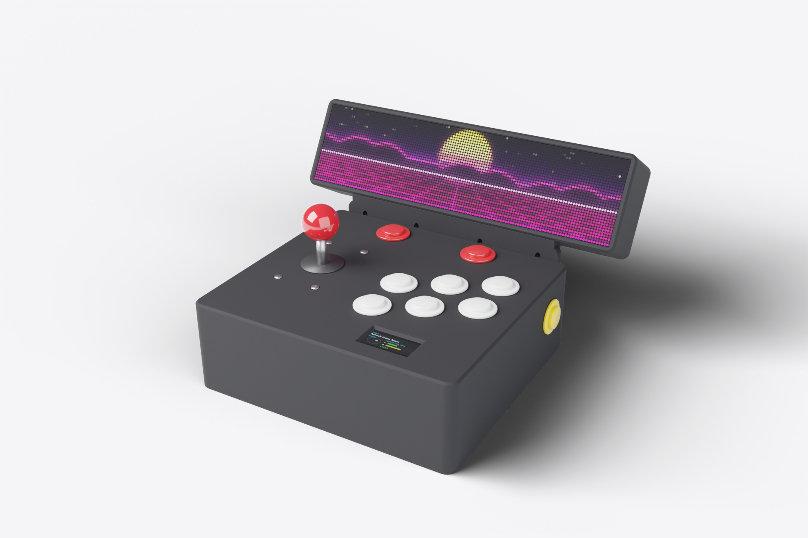

| | |
|---|---|
| 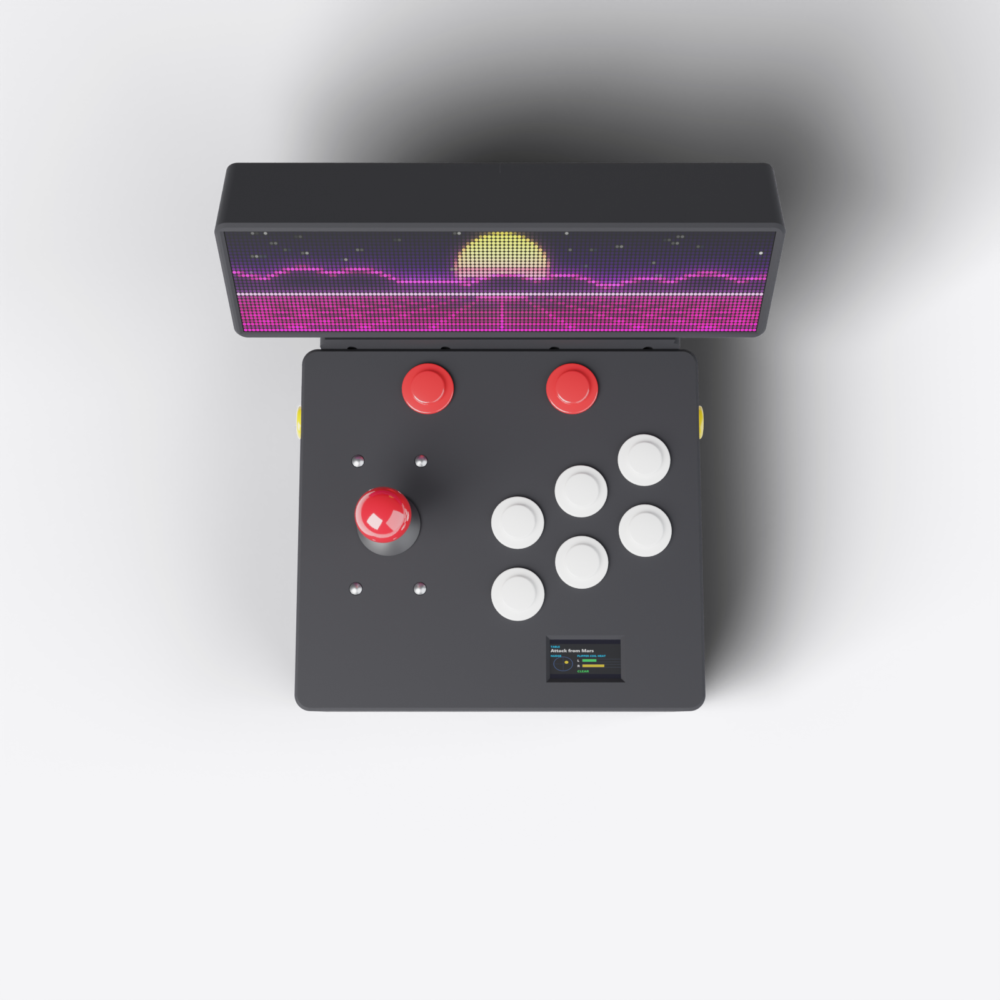 | 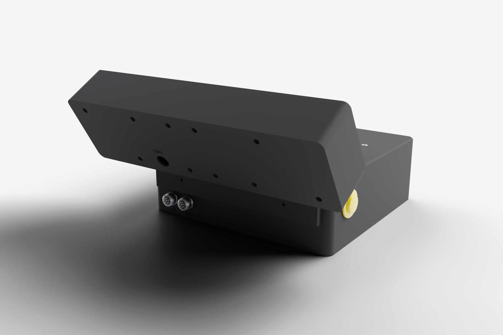 |

- **Flipper buttons in the side walls**, each firing a **JF-1039 solenoid** for 0.1 s — done by two
  timer relays, so the knock needs no PC software and has no lag
- **Haptic table sounds**: VPX sends the playfield sounds (flippers, bumpers, the rolling ball) to a USB
  sound card, an amp and a 50 mm exciter glued under the palm rest
- **Nudge and tilt** with a Raspberry Pi Pico running [Pinscape Pico](https://github.com/mjrgh/PinscapePico)
  and an LIS3DH accelerometer
- **Arcade layout** too: joystick, 6 buttons, coin and start — a normal gamepad for RetroBat / MAME
- **128 × 32 LED marquee** (two P2.5 HUB75 panels, ESP32 running [ZeDMD](https://github.com/PPUC/ZeDMD)):
  the live DMD in pinball, the game's logo while you browse RetroBat, a neon synthwave show when idle
- **Status screen** (LilyGO T-Display-S3): nudge meter, tilt warnings, flipper-coil heat, the table name
- **One cable in**: 12 V and USB on a single GX16-8 cable; one more to the marquee
- **Prints without supports** on any 256 mm bed; ready-made Bambu Studio projects with every setting;
  fully parametric OpenSCAD model

---

## Contents

1. [How it works](#how-it-works)
2. [Parts list](#parts-list)
3. [Step 1 — Print the parts](#step-1--print-the-parts)
4. [Step 2 — Prepare the electronics](#step-2--prepare-the-electronics)
5. [Step 3 — Wire it up](#step-3--wire-it-up)
6. [Step 4 — Bench test](#step-4--bench-test)
7. [Step 5 — Assemble](#step-5--assemble)
8. [Step 6 — Set up the PC](#step-6--set-up-the-pc)
9. [Customising](#customising)
10. [Troubleshooting](#troubleshooting)
11. [Design notes](#design-notes)
12. [Build it with Claude Code (optional)](#build-it-with-claude-code-optional)
13. [Repository layout](#repository-layout)
14. [Credits & licence](#credits--licence)

---

## How it works

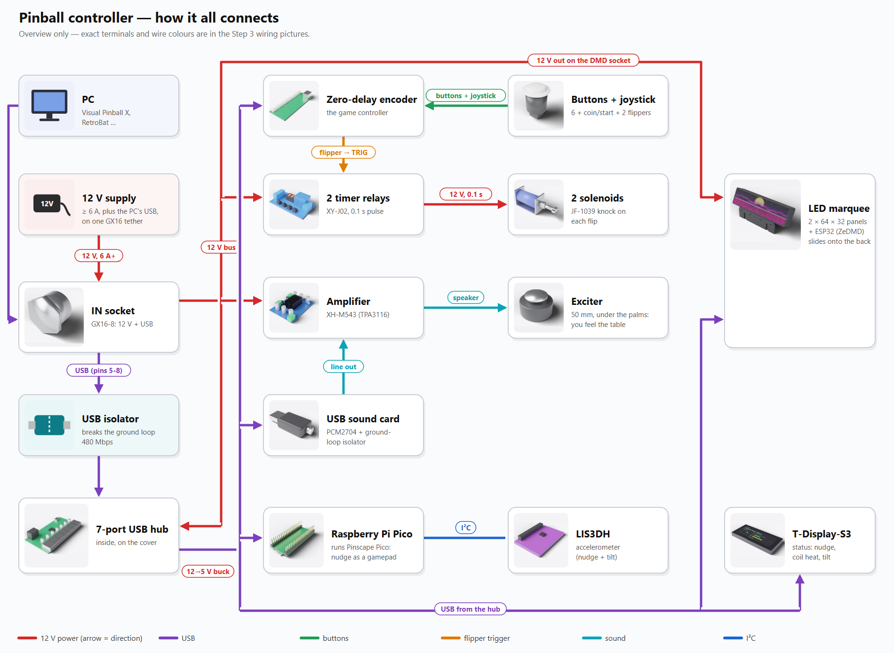

**One cable** brings **12 V** (pins 1-4) and the PC's **USB** (pins 5-8) into the **IN** socket on the
back. The 12 V goes to two lever-connector bars inside; the USB goes through a **USB isolator** into a
**7-port hub** on the cover plate, which carries every board.

- **Buttons and joystick** go to a **zero-delay USB encoder** — a plain gamepad on the PC.
- **Flippers**: each flipper button's own signal on the encoder (5 V while pressed) also triggers an
  **XY-J02 timer relay**. The relay closes for 0.1 s and pulls in its **solenoid**; when it lets go,
  the spring fires the plunger into a striker block in the side wall: the knock. Pure hardware.
- **Sound**: VPX plays the playfield sounds on a **USB sound card**; an **amplifier** drives the
  **exciter** stuck under the top panel, so you feel the ball and the flippers.
- **Nudge**: a **Raspberry Pi Pico** with an **LIS3DH** accelerometer runs Pinscape Pico and reports the
  box's shoves as gamepad axes; VPX turns them into nudges.
- **Marquee**: the **DMD** socket passes 12 V and USB on to the marquee, where a 10 A converter powers
  two LED panels and an **ESP32** draws the picture.
- **Status screen**: a **T-Display-S3** in the palm rest, fed by a small helper program on the PC.

---

## Parts list

The links are examples that match the dimensions the case is designed for (no affiliate links). Equivalent
parts from any seller work; check the sizes in the Notes column.

### Electronics — the controller

| | # | Part | Qty | Notes | Buy |
|---|---|---|---|---|---|
| 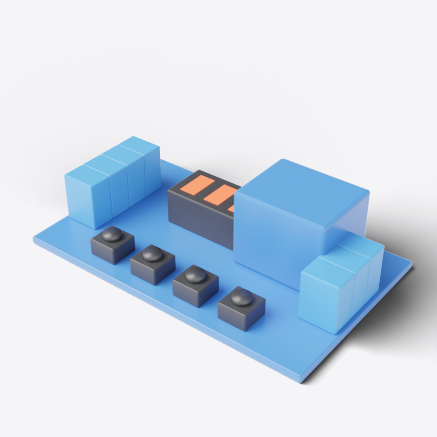 | 1 | **XY-J02 timer relay module** (62 × 38, 3-digit display) | 2 | One per flipper. Mode **P1.1**, time **00.1 s** | [AliExpress](https://www.aliexpress.com/item/1005006061497907.html) |
| 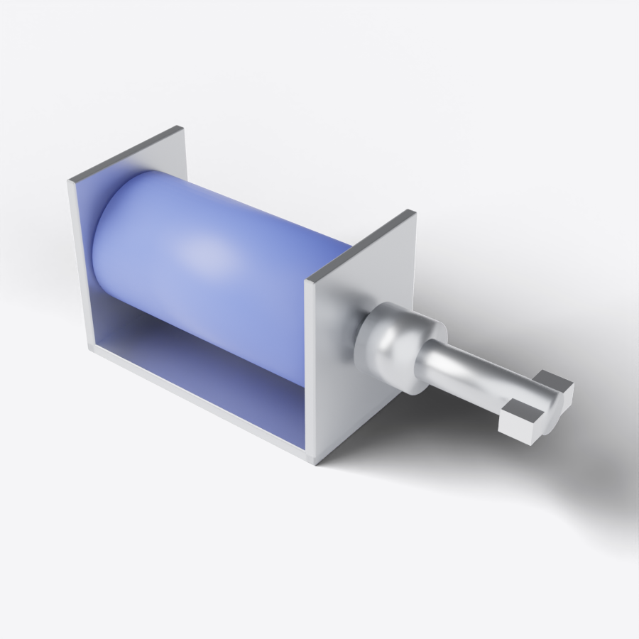 | 2 | **JF-1039 / JF-1039B pull solenoid, 12 V**, 10 mm stroke | 2 | 39 × 20 × 26 body, 2 × M4 tapped holes (diagonal). ~2.4 A each | [AliExpress](https://www.aliexpress.com/item/32618067363.html) |
| | 3 | **1N5408 diode** | 2 | Across each solenoid (flyback) | any |
| 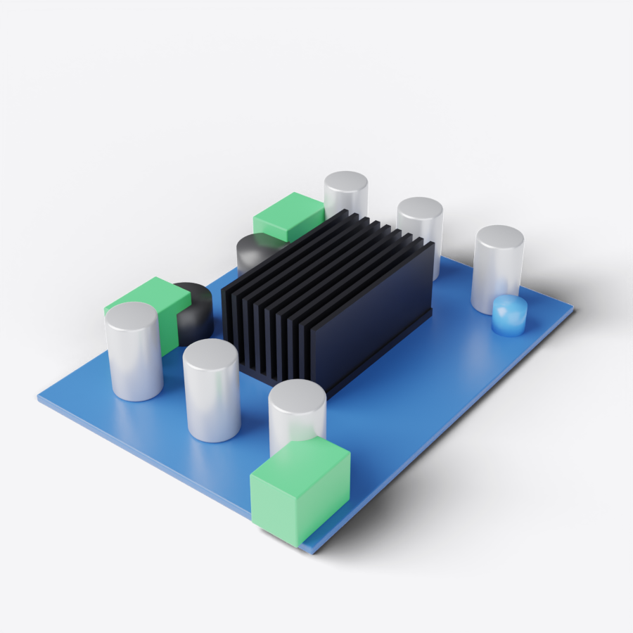 | 4 | **XH-M543 amplifier** (TPA3116D2, 2 × 50 W) | 1 | 92 × 68 × 20, holes 85 × 61 | [AliExpress](https://www.aliexpress.com/item/1005006109387002.html) |
| 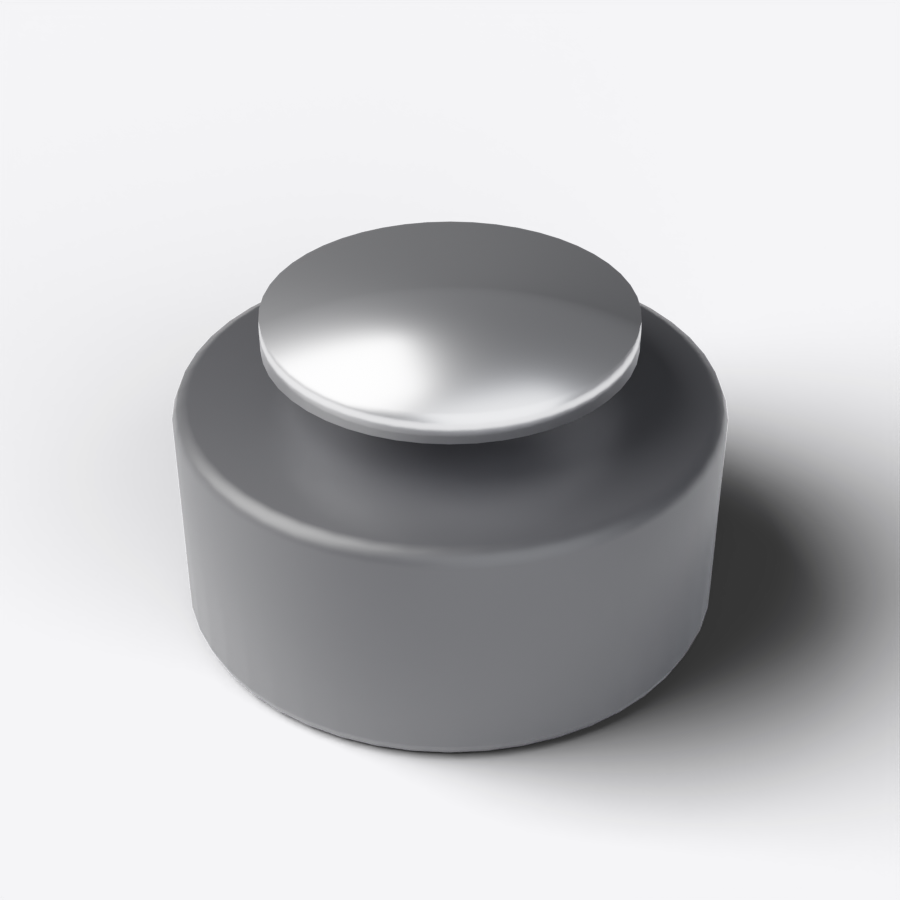 | 5 | **50 mm exciter, 4 Ω 25 W** (adhesive pad) | 1 | Ø33.5 pad, Ø50 body, 30 mm tall | [AliExpress](https://www.aliexpress.com/item/1005006966003188.html) |
| 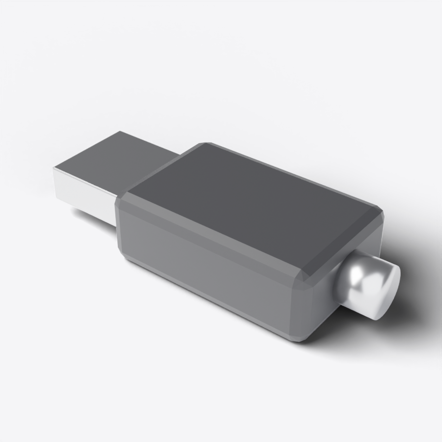 | 6 | **PCM2704 USB sound card** stick | 1 | Plugs straight into the hub | [AliExpress](https://www.aliexpress.com/item/1005005566082274.html) |
| | 7 | **3.5 mm ground-loop isolator** + 3.5 mm-to-bare-wire lead | 1 + 1 | Stops the hum between the sound card and the amp | any car-audio one |
| 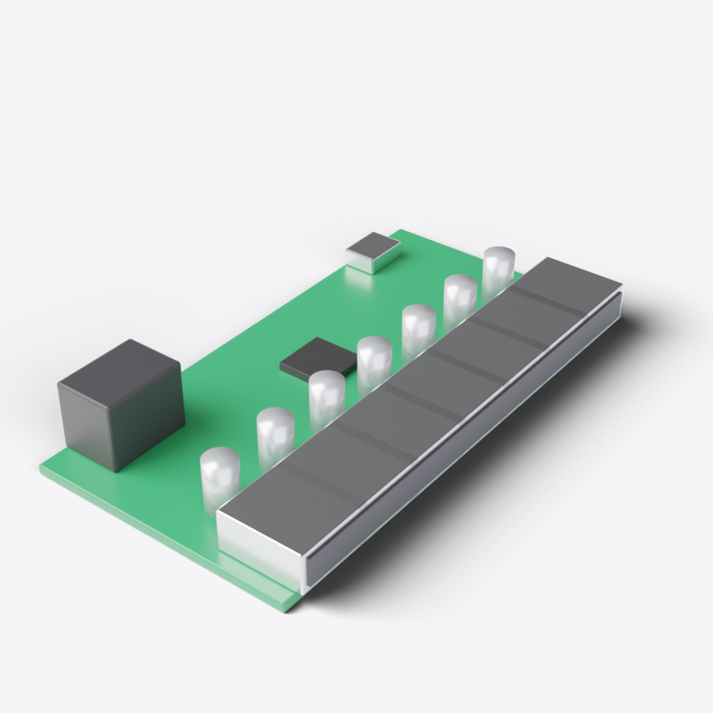 | 8 | **7-port USB 2.0 hub board** (FE2.1, 84 × 44, 5 V jack, micro-USB in) | 1 | Holes 78.4 × 38.5 | [Amazon](https://www.amazon.ca/dp/B09G6Y7R2Y) |
| | 9 | **12 → 5 V buck converter, 3 A** (MP1584 type) | 1 | Powers the hub. Set / check 5.0 V before connecting | [Amazon](https://www.amazon.ca/dp/B08HK6Z91G) (6-pack) |
| | 10 | **USB isolator, 480 Mbps** (ADuM3165 type, e.g. DSD TECH SH-G01B) | 1 | **Required** — see [Design notes](#design-notes). A 12 Mbps (ADuM3160) one passes everything except the sound card | [Amazon](https://www.amazon.ca/s?k=DSD+TECH+SH-G01B) |
| 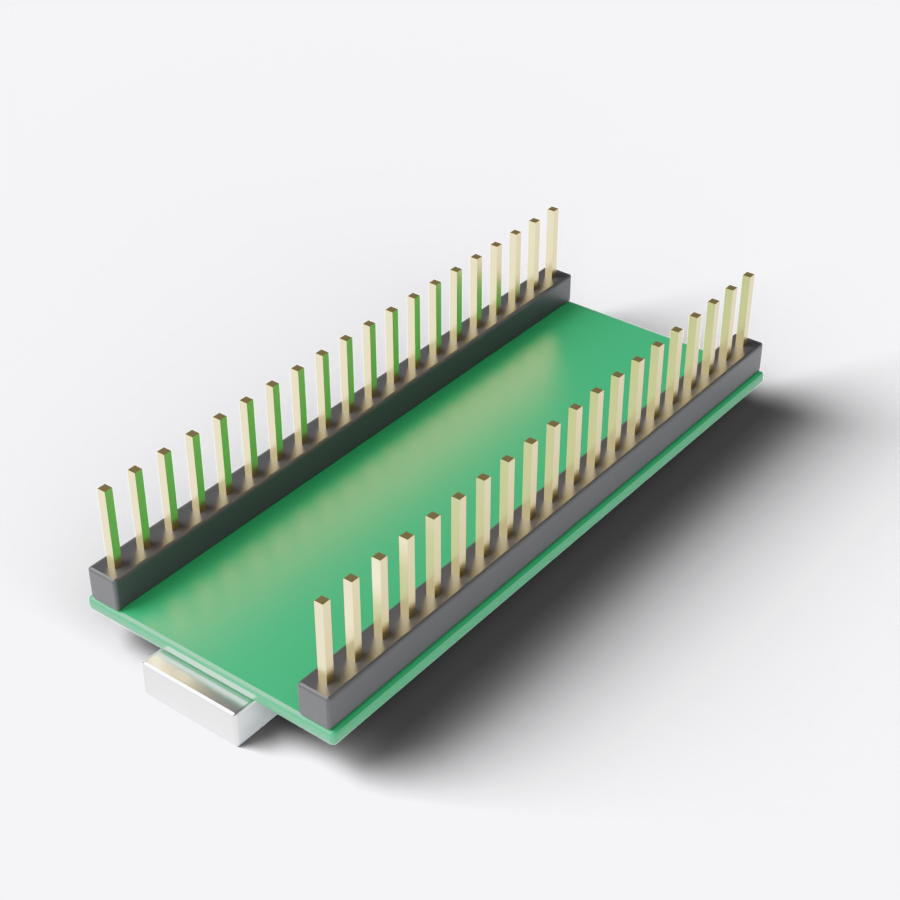 | 11 | **Raspberry Pi Pico H** (RP2040, headers on) | 1 | The plain RP2040 Pico; the firmware file is `PinscapePico-pico.uf2` | [AliExpress](https://www.aliexpress.com/item/1005008058623788.html) |
| 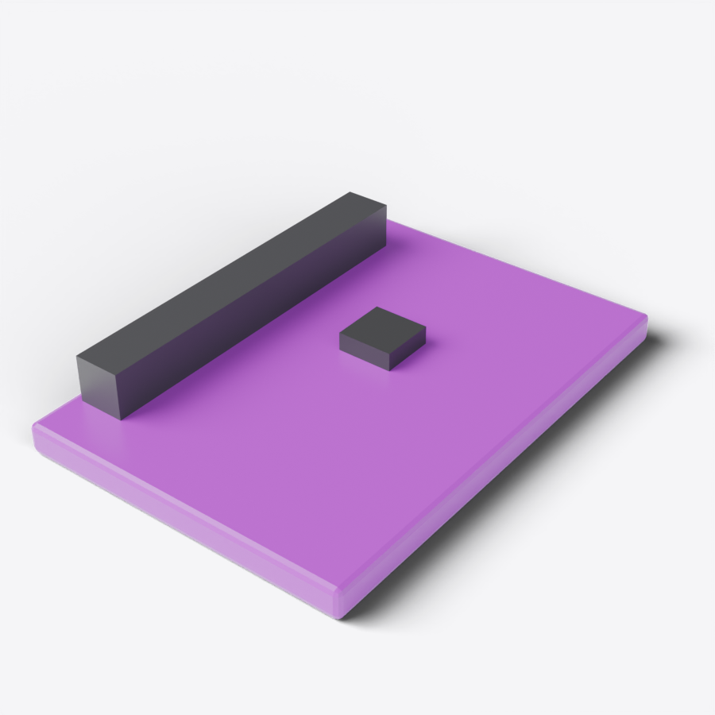 | 12 | **LIS3DH accelerometer breakout** | 1 | 3.3 V only; two mounting holes 23 mm apart | [AliExpress](https://www.aliexpress.com/item/1005007384668203.html) |
| 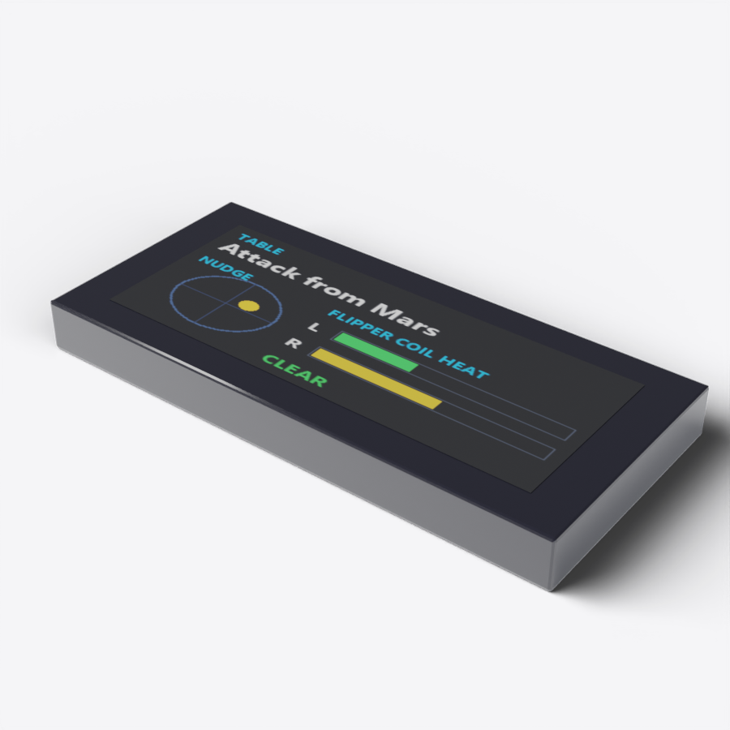 | 13 | **LilyGO T-Display-S3** (1.9" LCD, not the AMOLED one) | 1 | Status screen | [LilyGO](https://lilygo.cc/products/t-display-s3) |
| | 14 | **USB-C male solder breakout** (4 pads V / D− / D+ / G) | 2 | T-Display and marquee ESP32 — no room for a cable plug | any |

### Controls

| | # | Part | Qty | Notes | Buy |
|---|---|---|---|---|---|
| 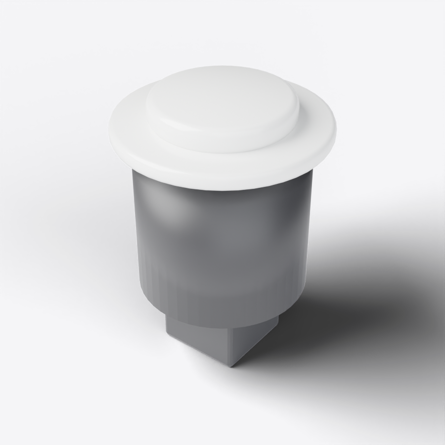 | 15 | **28 mm arcade buttons** (switch built in, 3-wire lead) | 10 | 6 action + coin + start + 2 flippers. ≤ 40 mm below the panel incl. connectors | any zero-delay kit |
| 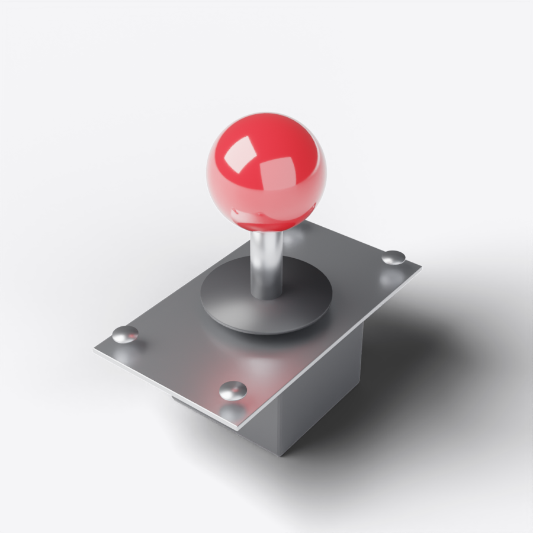 | 16 | **Joystick**, 95 × 54 plate, 5-pin lead | 1 | 40 × 81 screw pattern, ≤ 35 mm body below the plate | any zero-delay kit |
| 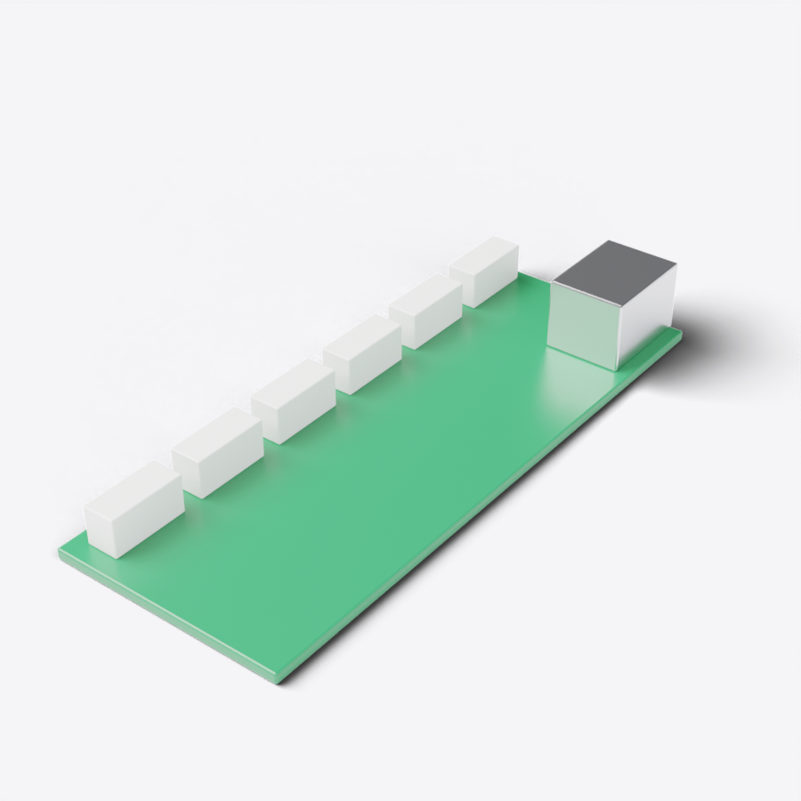 | 17 | **Zero-delay USB encoder** (EG Starts / "DragonRise", 86 × 36) | 1 | Its USB cable is **soldered** to the USB-B pins (no room for a plug) | any zero-delay kit |

### Power and connectors

| | # | Part | Qty | Notes | Buy |
|---|---|---|---|---|---|
| 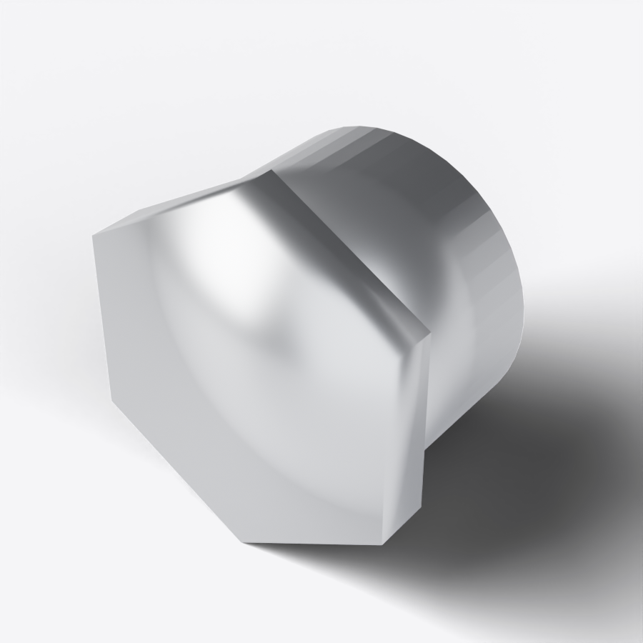 | 18 | **GX16-8 panel socket + plug** | 3 pairs | IN (controller), DMD (controller), DMD (marquee). Ø16.3 panel hole | [Amazon](https://www.amazon.ca/dp/B07D2675JW) (5-pair kit) |
| | 19 | **8-core 22 AWG shielded cable** | 2 m + 0.5 m | The tether and the marquee link, wired pin-for-pin | [Amazon](https://www.amazon.ca/dp/B0DL9RGWYY) |
| | 20 | **12 V power supply, ≥ 6 A** | 1 | A double flip draws ~5 A for 0.1 s. Use a supply with screw terminals or a solid connector — a loose barrel jack resets the box on every flip | any |
| | 21 | USB-A female socket (solder), USB-A plug pigtail, micro-USB 90° adapter, short USB-A → micro-USB cable | 1 each | Tether USB → isolator; hub → DMD socket; hub input; Pico | any |
| | 22 | **Lever connectors** (WAGO 221, 5-way) | 4 | The +12 V and 0 V bars | any |
| | 23 | Wire: 18 AWG red / black (12 V), 22-24 AWG (signals), heat-shrink, spade connectors | — | | any |

### Marquee

| | # | Part | Qty | Notes | Buy |
|---|---|---|---|---|---|
| 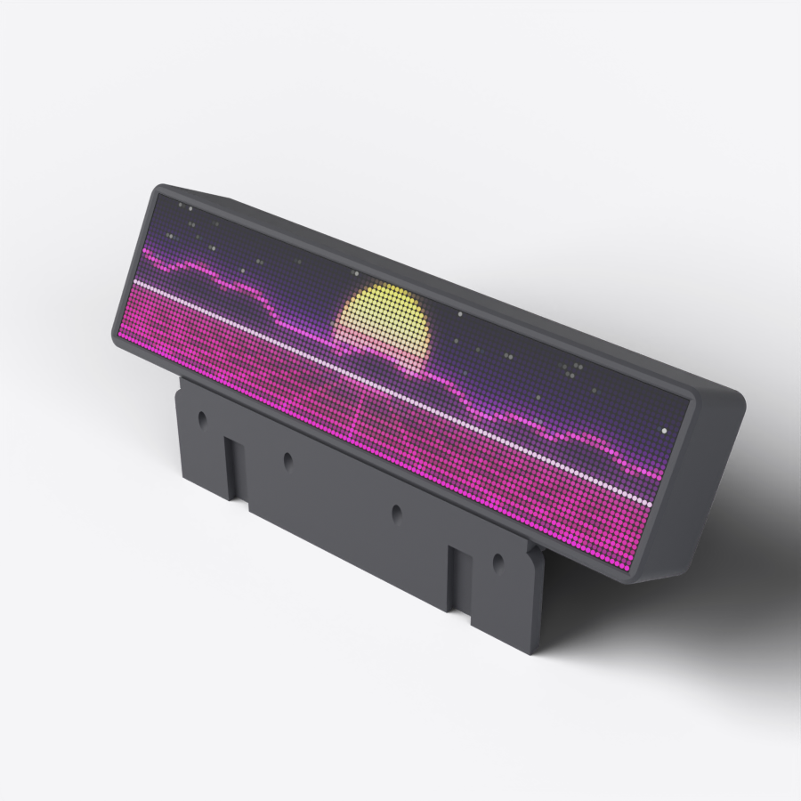 | 24 | **P2.5 64 × 32 HUB75 LED panel** (1/16 scan) | 2 | 160 × 80 × 15 each, M3 inserts on 125 × 65 | [AliExpress](https://www.aliexpress.com/item/4000002686894.html) |
| | 25 | **ESP32-WROOM-32 dev board**, CP2102, USB-C | 1 | ≈ 29 × 52 | [Amazon](https://www.amazon.ca/s?k=ELEGOO+ESP-32+3pcs+Type-C) (3-pack) |
| | 26 | **12 → 5 V converter, 10 A**, potted | 1 | 63 × 32 × 18 with ears | [AliExpress](https://www.aliexpress.com/item/1005007025522625.html) |
| | 27 | Dupont jumpers, female-female, 20 cm | 16 | ESP32 → panel | any |

### Hardware

**Rule: every joint between printed parts is an M3 heat-set insert and an M3 screw.** Boards are held by
plain machine screws driven straight into the printed posts (they cut their own thread).

| Part | Qty | Used for |
|---|---|---|
| M3 heat-set insert (M3 × 5, Ø4.0 hole) | 21 | cover ↔ case 6, T-Display clamp 4, exciter catch 2, marquee: tray floors 4, seam 3, rails 2 |
| M3 × 8 machine screw | 32 | relays, amp, hub, encoder, T-Display clamp, exciter catch, marquee plate |
| M3 × 10 countersunk | 6 | cover → case |
| M3 × 10 socket / pan head | 13 | marquee seam 3, LED panels 10 |
| M4 × 10 countersunk | 4 | solenoids (into their tapped frames) |
| M4 × 8 countersunk | 4 | joystick |
| M2 × 10 | 8 | Pico 4, ESP32 4 |
| M2.5 × 8 | 2 | LIS3DH |
| 3M Bumpon SJ5312 rubber feet (Ø12.7) | 6 | recesses under the cover |
| Steel M4 washer | 2 | glued on each striker face |
| Zip ties 4 mm, 3M VHB tape, ~2 mm foam tape | — | cable runs (17 printed tie mounts), exciter pad, T-Display |

### Printed parts

| Part | Print time | Filament |
|---|---|---|
| Case | ≈ 12.6 h | ≈ 559 g |
| Cover (the electronics plate) | ≈ 5.2 h | ≈ 202 g |
| 2 marquee trays | ≈ 7.5 h | ≈ 338 g |
| Marquee mounting plate | ≈ 2.2 h | ≈ 85 g |
| T-Display clamp + exciter catch | ≈ 0.3 h | ≈ 12 g |

PLA, 0.4 mm nozzle, 0.20 mm layers — about **28 h and 1.2 kg** (Bambu A1 estimates), plus ≈ 1 h for the test prints.

### Tools

Soldering iron (also for the inserts), multimeter, small screwdrivers and hex keys, side cutters,
heat gun or lighter for heat-shrink, a Windows PC.

---

## Step 1 — Print the parts

Every print file has its settings built in. Pick your printer's folder in [`print/`](print/README.md) —
**`bambu-a1/`**, **`bambu-p1s/`** or **`bambu-x1c/`** — and print:

1. **`test_prints.3mf`** first (≈ 1 h): a fit coupon (solenoid cradle, a button hole, the GX16 hole) and
   a screw-post test. Check a button and a GX16 socket fit, and that an M3 screw grips the 3.0 mm post.
2. **`cover.3mf`**, then **`case.3mf`** (the big one: it fills a 256 mm bed, turned 90°).
3. **`marquee_trays.3mf`**, **`marquee_plate.3mf`**, **`small_parts.3mf`**.

No supports anywhere. The case has no brim (no room); a clean plate (dish soap and water), a 65 °C first
layer and a draft-free room hold it down. Other slicers: STLs and settings are in [`print/`](print/README.md).

After printing, melt the M3 heat-set inserts in (≈ 210 °C for PLA, iron square to the hole): 6 in the
case's cover posts, 4 in the T-Display posts, 2 in the exciter pillars, and the marquee ones (Step 5).

---

## Step 2 — Prepare the electronics

**2.1 Program the two relays.** Power each XY-J02 from 12 V on the bench. Long-press **SET**, choose
**P1.1**, set the time to **00.1** (short-press STOP cycles the decimal point: XXX. seconds, XX.X tenths —
0.1 s is the shortest step), long-press SET to save. One trigger = one 0.1 s pulse, however long the
button is held — the coils are only rated for 2 s on.

**2.2 Set the converters.** With nothing on the output, power each buck converter and check (or set) the
output: **5.0 V** for the hub's buck, **5.0 V** for the marquee's 10 A converter.

**2.3 Flash the boards** — details in [firmware/README.md](firmware/README.md):
- Pico: **Pinscape Pico v1.0.2** + [`firmware/pinscape_config.json`](firmware/pinscape_config.json)
- Marquee ESP32: **ZeDMD 5.1.8** with this project's patch (picture turned 180°, attract show)
- T-Display-S3: `pio run -d status-display -t upload`

**2.4 Solder the encoder's USB cable** to its USB-B pins (red 1 = 5 V, white 2 = D−, green 3 = D+,
black 4 = GND) — the plug doesn't fit under the panel. Cut a USB-A cable for it.

**2.5 Make the tether.** 2 m of 8-core cable with a GX16-8 plug on each end, **pin for pin** (1 → 1 …
8 → 8). At the supply end, pins 1 + 2 = +12 V, 3 + 4 = 0 V (18 AWG-ish, two pins each), 5-8 = a USB-A
plug to the PC (red 5, white 6, green 7, black 8). Shield to 0 V at the supply end only. The 0.5 m
marquee link is the same, without the supply.

**2.6 Beep-test every GX16 cable and socket** before anything is powered:
[`docs/gx16_test.png`](docs/gx16_test.png) shows the pin numbers on the face; no pin may beep to any
other, and 12 V must never reach pins 5-8. A loose wire here killed three hubs during the build.

---

## Step 3 — Wire it up

Wire it in six steps — each picture highlights only that step's wires and lists them on the right. A
small bridge means two wires cross without touching; a dot means they join. Build the cover on the bench
first (every board sits on it), then the case parts.

**3.1 Power**

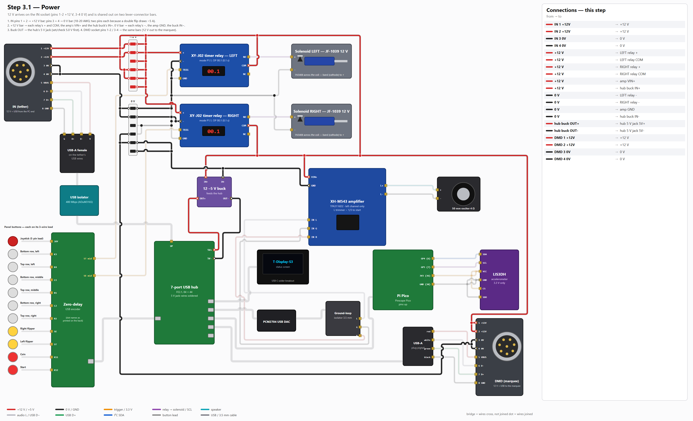

**3.2 Flipper solenoids**

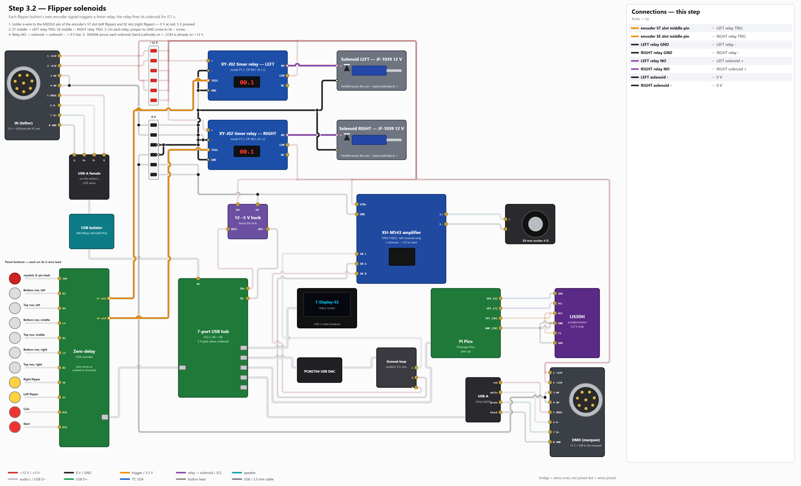

**3.3 Buttons and joystick**

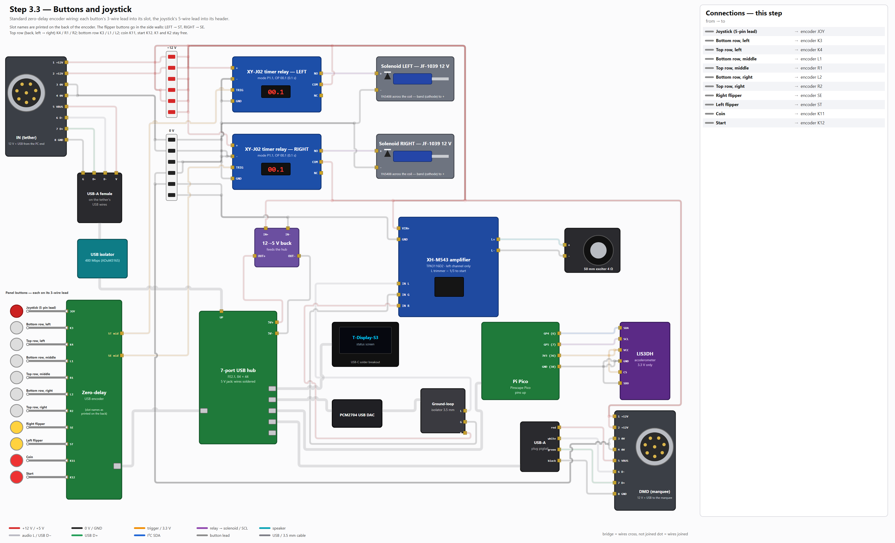

| Button | Encoder slot | PC button number |
|---|---|---|
| Left / right flipper (side walls) | ST / SE | 10 / 9 |
| Top row, left → right | K4 / R1 / R2 | 4 / 6 / 8 |
| Bottom row, left → right | K3 / L1 / L2 | 3 / 5 / 7 |
| Coin / start | K11 / K12 | 11 / 12 |

**3.4 USB**

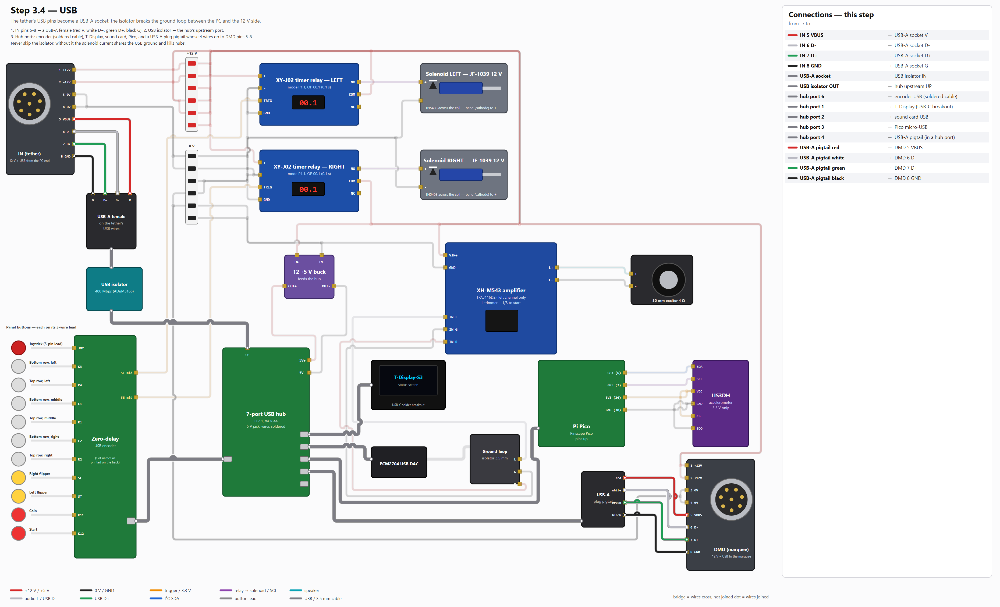

**3.5 Sound**

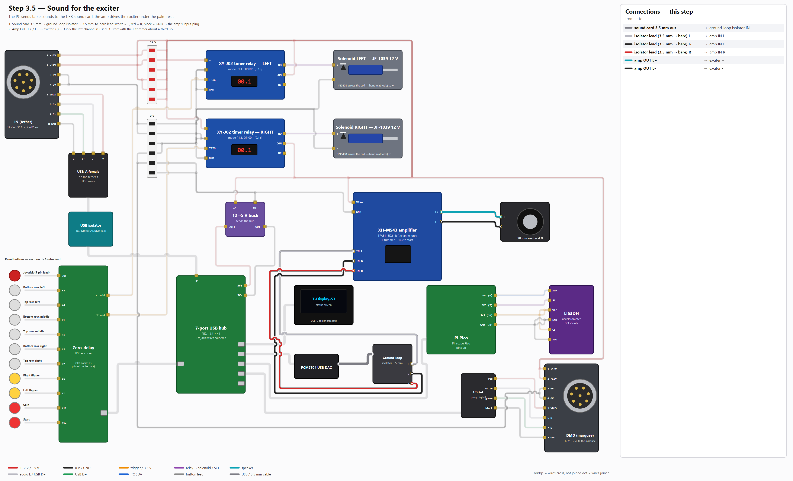

**3.6 Nudge**

**All together** ([full-size SVG](images/wiring.svg)):

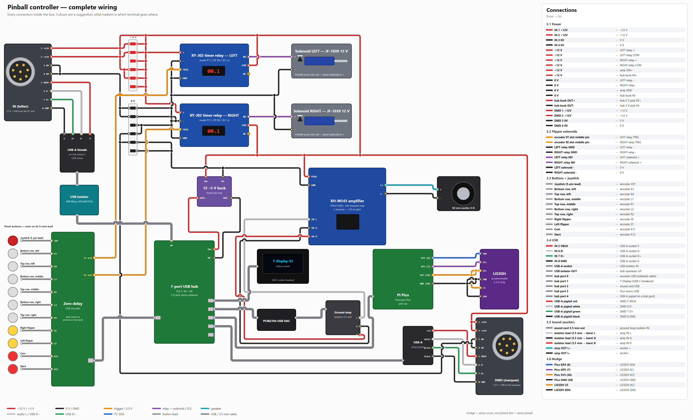

**The marquee** ([SVG](images/wiring_marquee.svg)):

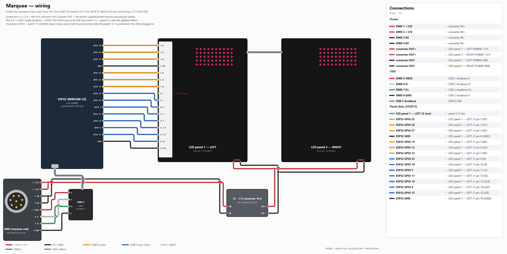

Wires that cross from the case to the cover (12 V, 0 V, the right-flipper trigger, the left one, the
exciter) go through small JST-XH plugs so the cover comes off without cutting anything. The cable runs
and the 17 printed zip-tie mounts are planned in [`docs/routing_cover.png`](docs/routing_cover.png) and
[`docs/routing_case.png`](docs/routing_case.png). Board terminals: [relay](docs/pinouts/relay_xyj02.png),
[amp](docs/pinouts/amp_xhm543.png).

---

## Step 4 — Bench test

With the cover populated and everything wired, before closing the case:

1. **Meter first.** Supply off: +12 V bar to 0 V bar is not a short; +12 V to every USB pin is open.
2. **12 V only (no USB):** both relay displays light, the amp's LED comes on. Touch the ST middle wire
   to the encoder's 5 V for an instant: one crisp knock on the left. Same for SE on the right. **Never
   fire a solenoid with nothing in front of the plunger** — the striker is what holds it in.
3. **Plug in USB:** the PC sees all five devices (list and check in [pc/README.md](pc/README.md)). The
   marquee shows its attract show, then the neon show once the PC side runs.
4. **Buttons:** `joy.cpl` → every button lights its number (table above); each flipper also knocks.
5. **Sound:** play something to "USB Audio DAC" — the exciter buzzes. Set the amp's left trimmer about a
   third up and raise it until loud passages just don't rattle.

---

## Step 5 — Assemble

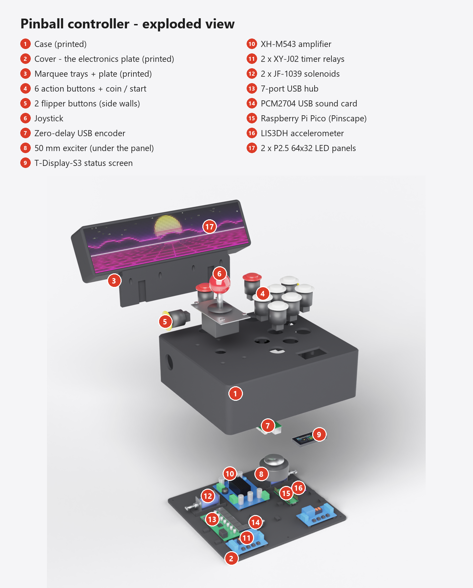

Inside, with the right half of the case cut away:

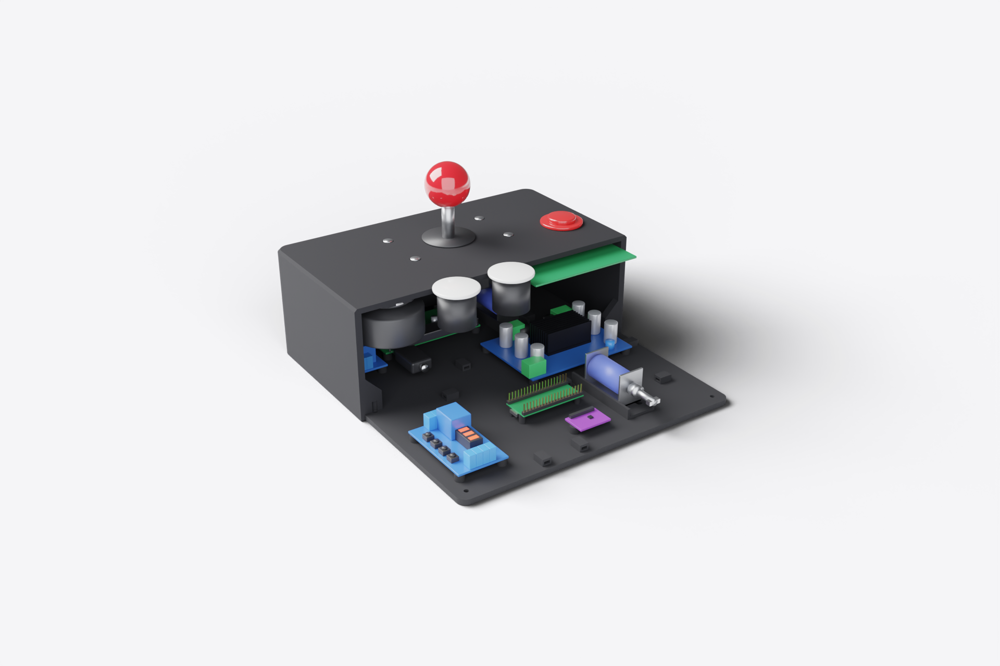

Where every board sits on the cover:

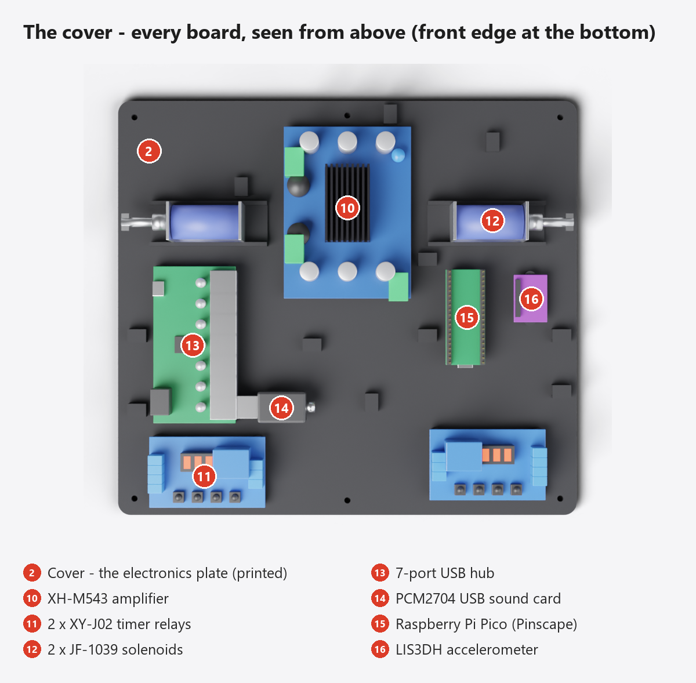

1. **Case parts:** buttons and joystick (4 × M4 × 8 countersunk from the top), encoder on its posts
   (4 × M3 × 8), the two GX16 sockets in the back wall (seen from the player: IN is the one nearer the
   right-hand side, DMD just left of it).
2. **Exciter (8):** IPA-clean the panel, VHB tape on the **aluminium pad**, press it pad-first into the
   small ring under the palm rest for 30 s; the body hangs free. Screw the printed catch across the two
   pillars (2 × M3 × 8) — it sits 2 mm under the exciter and only catches it if the tape ever lets go.
3. **T-Display (9):** clip its header pins flush, drop it face-down into the window pocket, foam tape on
   the clamp, 4 × M3 × 8.
4. **Cover (2):** solenoids (12) with M4 × 10 countersunk from below, relays (11), amp (10), hub (13),
   Pico (15, pins up, USB toward the front), LIS3DH (16, square to the box), buck — all with machine
   screws into the posts. Dress each wire run through its tie mounts.
5. **Strikers:** glue a steel M4 washer on each striker face in the case's side walls.
6. **Close:** plug the case ↔ cover JST plugs and USB leads, lower the case onto the cover, 6 × M3 × 10
   countersunk. Slide each solenoid in its slots until the plunger presses the striker with **~3 mm of
   spring preload**, then tighten.
7. **Feet:** six SJ5312 bumpers into the recesses underneath.
8. **Marquee (3, 17):** melt the inserts in (3 in the right tray's seam bulkhead, 2 per tray floor, 1
   into each case rail through the plate's guide hole). ESP32 on the left tray's end wall
   (4 × M2 × 10), 10 A converter against the right tray's back wall (VHB), GX16 socket in the right tray.
   Wire per the marquee picture, drop each panel in face-first and screw it from behind (5 × M3 × 10
   each). Screw the trays together (3 × M3 × 10 through the seam), screw the plate on **before** sliding
   it onto the case — see [`docs/renders/marquee_plate_screws.png`](docs/renders/marquee_plate_screws.png)
   — then slide it down the back-wall rails and fix it with one M3 × 8 per rail.

---

## Step 6 — Set up the PC

Everything on the PC — VPX buttons and nudge, sending table sounds to the exciter, the DMD on the
marquee, RetroBat, and the three small background programs (marquee, exciter sound, status screen):
**[pc/README.md](pc/README.md)**.

| | |
|---|---|
| **Flippers** | side buttons — knock on every press |
| **Nudge** | shove the box; a hard shove can tilt the table, as on a real machine |
| **Coin / start** | the two red buttons on the back edge |
| **Arcade games** | joystick + 6 buttons; coin + start together quits |
| **Marquee** | game DMD in pinball, logos in RetroBat, neon show when idle |
| **Status screen** | nudge meter, tilt warnings, coil heat (it turns red with "REST IT" — let the coils cool) |

---

## Customising

- **Case** — `model/pinball_controller_v2.scad` (OpenSCAD) is fully parametric: size, button layout,
  every board's position and screw size, the solenoid cradles, the exciter ring, the marquee. Set `part`
  to `case`, `cover`, `marquee_tray_left` … or one of the `*_loaded` / `assembly` views. The `echo()`
  checks warn about collisions; `python docs/assembly_audit.py` (must show no CLASH) and
  `python docs/cable_router.py` (0 errors) check the whole assembly and the cable runs. Then
  `python tools/make_print_files.py` rebuilds every STL and 3MF.
- **Knock** — relay time 00.1 (tighter) up to 00.2 (longer pull, same knock); solenoid preload by sliding
  it in its slots.
- **Nudge feel** — VPX dead zone and gain ([pc/README.md](pc/README.md)); axis signs in
  `firmware/pinscape_config.json`.
- **Marquee show** — scenes and transitions in [`tools/synthwave/render.py`](tools/synthwave/render.py);
  `python tools/synthwave/render.py out` writes preview GIFs. The ESP32's own attract show: `tools/attract_text.py`.
- **Wiring pictures, overview, renders** — `tools/make_wiring_diagrams.py`, `tools/make_overview.py`,
  `renders/` (Blender).

---

## Troubleshooting

| Problem | Fix |
|---|---|
| The whole controller resets when you flip (both flippers especially) | The 12 V supply path can't deliver ~5 A: a weak supply, a loose barrel jack or screw terminal, thin wire. Use 18 AWG and both GX16 pins per polarity; tighten every 0 V screw |
| USB devices drop out on flips, hubs die | The USB ground is carrying coil current — fit the **USB isolator** (Design notes) and check the 0 V path |
| Hum from the exciter | Ground-loop isolator between the sound card and the amp |
| Sound card listed but no sound, behind the isolator | It's a 12 Mbps isolator — use a 480 Mbps (ADuM3165) one |
| Marquee red / dark / "ZeDMD not found" | The marquee must have its **12 V whenever its USB is connected**; replug the marquee cable (12 V + USB together). Never open its COM port in a tight loop — every open reboots the ESP32 |
| Marquee picture upside down | You turned on a flip option in `DmdDevice.ini` — turn it off (the firmware already turns it) |
| Green and blue swapped on the marquee | ZeDMD RGB order 3 |
| A flipper knocks while held, or on its own | Relay not in P1.1, or its TRIG is on the wrong encoder pin (must be the ST/SE **middle** pin: 0 V at rest, 5 V pressed) |
| Ball moves the wrong way on a nudge | Axis signs in `pinscape_config.json` or `UDAxisFlip` in VPX |
| The table tilts or nudges by itself when you flip | The knock shakes the accelerometer — raise VPX's dead zone |
| Coin / start do nothing until you click the table | VPX's window doesn't have focus; the marquee service gives it back. Make sure it's running |
| Windows plays everything through the exciter | It made the USB sound card the default output when it appeared; switch the default back (pc/README.md) |

---

## Design notes

**Grounds and the USB isolator.** The tether carries both the 12 V coil current (pins 1-4) and USB
(pins 5-8). USB's own ground (pin 8) is joined to the 0 V side at both ends — at the hub on the
controller and at the PC — so it runs in parallel with pins 3/4. Any resistance in the 0 V path (a loose
terminal, a thin wire, a cheap barrel jack) pushes part of each 2-5 A coil pulse through USB ground
instead: links drop on every flip, and during this build it burned out several hub boards. A **USB
isolator** in the controller's USB input breaks that loop — USB ground then only goes back to the PC,
and the coil current can only return on pins 3/4. It needs to be a **480 Mbps** type (ADuM3165): the
cheaper 12 Mbps ADuM3160 passes the encoder, the Pico, the marquee and the screen, but Windows can't open
the USB sound card through it.

**Power budget.** Two solenoids ≈ 4.8 A for 0.1 s, the marquee up to ≈ 3 A at 12 V on full white
(far less on DMD content), the amp ≈ 1 A on loud passages, the logic < 0.5 A. A 6 A or bigger 12 V supply
with solid connections is enough; each GX16 pin is rated 5 A, which is why 12 V and 0 V use two pins
each.

**Why hardware flippers.** Triggering the relays straight from the encoder's flipper signal means the
knock follows the button with no driver, no DOF configuration and no USB latency, and it works with every
game. The knock is the spring firing the plunger when the coil lets go, so a 0.1 s pulse knocks as hard
as a longer one and stays cool.

**Case.** 254 × 230 × 85 mm — 254 is the widest that fits a 256 mm bed, printed turned 90° so the
nozzle never reaches the end of the A1's X travel on the wide top layers. The top layout (joystick, six
buttons, coin / start) is unchanged from the original design. Everything electrical lives on the
removable cover, so the case is just a shell with buttons.

---

## Build it with Claude Code (optional)

This repository includes a [`CLAUDE.md`](CLAUDE.md) that turns [Claude Code](https://claude.com/claude-code)
into a build assistant for this project. It knows the parts, the wiring, the safety checks, the firmware
and the PC setup, and it can run the flashing and configuration commands for you (it asks before each
one).

1. Install Python 3 and Claude Code, and sign in.
2. Get this project (`git clone` or download the ZIP), open a terminal in its folder and run `claude`.
3. Ask things like:
   - *"Walk me through Step 3.2, one wire at a time."*
   - *"Here's a photo of my relay — which screw is TRIG?"*
   - *"My Pico is plugged in holding BOOTSEL. Flash Pinscape and load the config."*
   - *"Set up the marquee service and the exciter sound on this PC."*
   - *"The controller resets when I press both flippers. Help me find out why."*

Take your time with the multimeter checks it asks for: they protect the hubs.

---

## Repository layout

| Folder | What's in it |
|---|---|
| [`print/`](print/README.md) | ready-to-print Bambu Studio projects for A1 / P1S / X1C, STLs, print settings |
| `model/` | the parametric OpenSCAD model (`pinball_controller_v2.scad`) |
| [`firmware/`](firmware/README.md) | Pinscape Pico config, the ZeDMD patch and attract show |
| [`status-display/`](status-display/README.md) | T-Display-S3 firmware, the PC helper and the exciter sound relay |
| [`pc/`](pc/README.md) | Windows / VPX / RetroBat setup |
| `tools/synthwave/` | the marquee service and the neon synthwave show |
| `tools/` | generators for the wiring pictures, the overview and the print files; test helpers |
| `docs/` | GX16 test sheets, cable routing, board pinouts, assembly and routing checks |
| `images/` | renders, wiring and overview pictures |
| `renders/` | Blender scripts that make the product renders |
| `CLAUDE.md` | instructions that make Claude Code a build assistant for this project |

---

## Credits & licence

- **Hardware design** (`model/`, `print/`, `images/`, `docs/`): **[CC BY-SA 4.0](https://creativecommons.org/licenses/by-sa/4.0/)**.
- **Code and scripts** (`firmware/`, `status-display/`, `tools/`, `renders/`, `pc/`): **[MIT](LICENSE-CODE)** —
  except the ZeDMD patch and attract-show files in `firmware/` (`zedmd-*.patch`, `attract_*.h`), which are
  built into ZeDMD and are **GPL-2.0** like ZeDMD itself.
- [Pinscape Pico](https://github.com/mjrgh/PinscapePico) © Michael J. Roberts (BSD-style licence);
  [ZeDMD](https://github.com/PPUC/ZeDMD) (GPL-2.0) and [libzedmd](https://github.com/PPUC/libzedmd) (GPL-3.0) © the PPUC team;
  [dmd-extensions](https://github.com/freezy/dmd-extensions) (GPL-2.0) © freezy; [Visual Pinball X](https://github.com/vpinball/vpinball);
  [RetroBat](https://www.retrobat.org/).

See [LICENSE](LICENSE).
